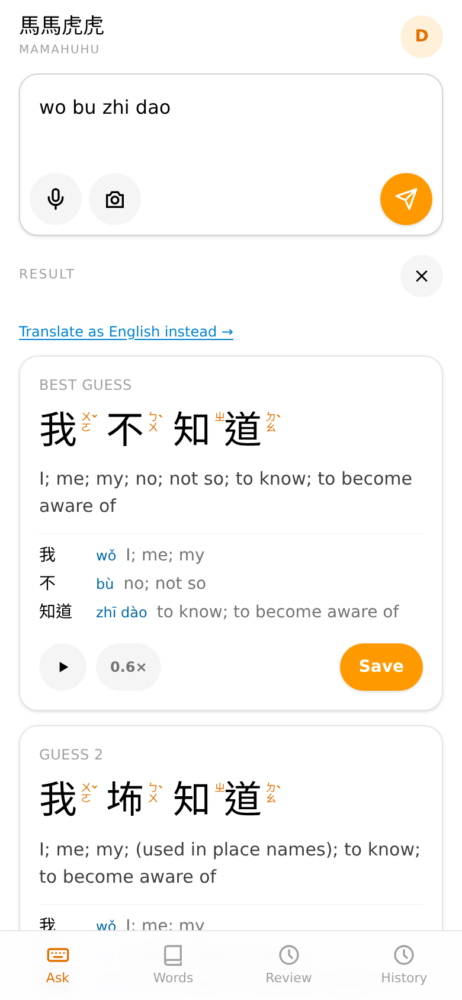
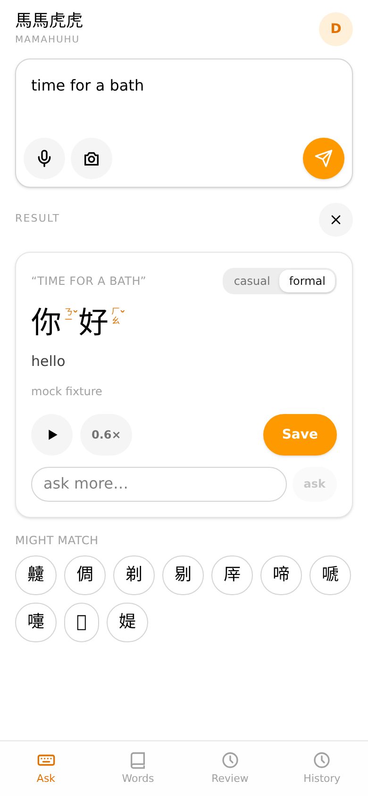
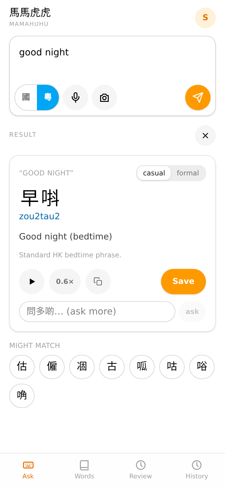
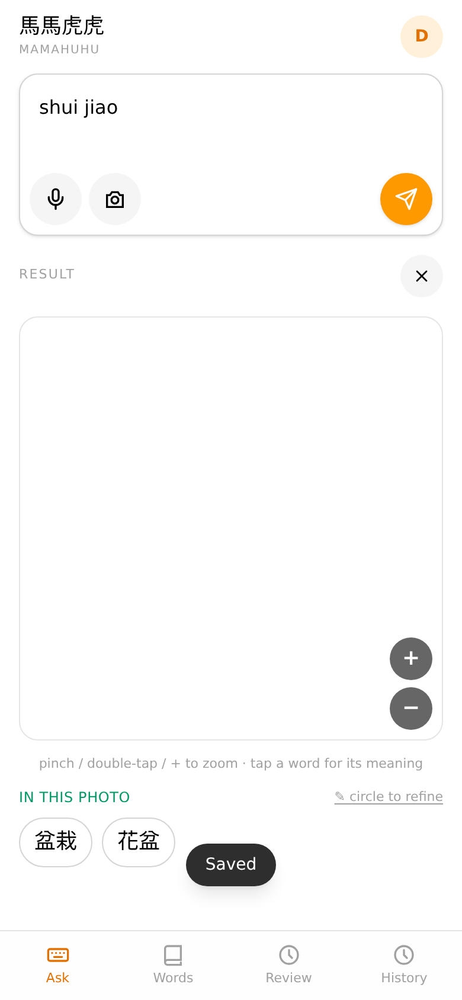
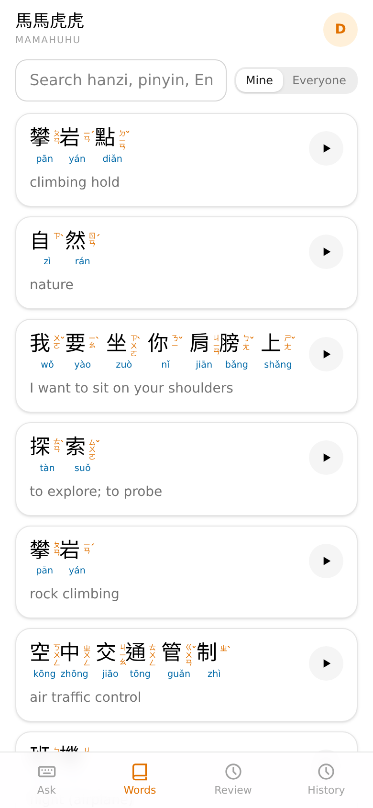
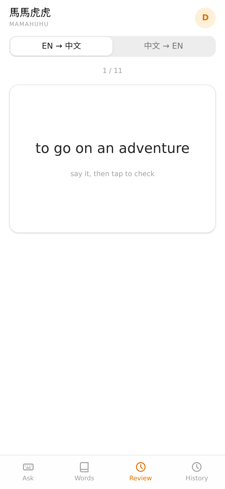
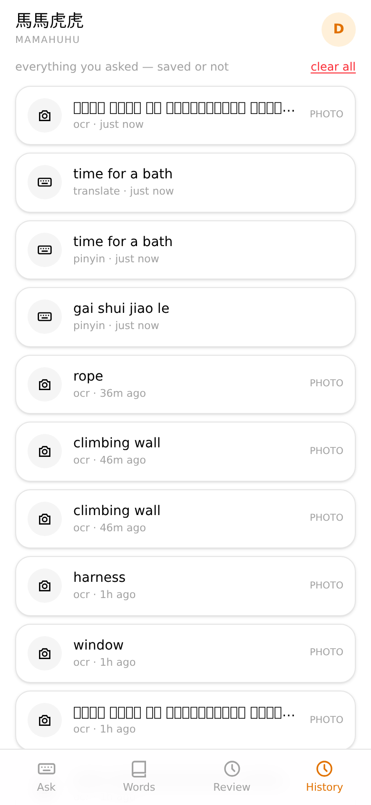

# Mamahuhu 馬馬虎虎

Mobile-first companion for a parent keeping up with a toddler: **Mandarin
(Taiwan, Traditional) and Cantonese (zh-HK)**. Ask — by typing, speaking,
or photographing — see hanzi with bopomofo and pinyin (jyutping for
Cantonese), save it, review it. 90% phone usage, ~15–30 second
interactions.

<div align="center">
  
  
  
  
</div>
<div align="center">
  <em>Rough pinyin in → best dictionary interpretations. English → casual/formal registers with sense chips.</em>
</div>

<div align="center">
  
  
  
</div>
<div align="center">
  <em>Your saved words (searchable by hanzi, pinyin, English, or topic tags). Leitner-box flashcards. Every ask, saved or not.</em>
</div>

## The four inputs

| Mode | What happens |
|---|---|
| **Type** | English → intent-first translation (casual + formal registers, alternative senses, meta-question handling: *"how do you say airplane"* → 飛機), with a **成語 card** when a Chinese idiom is in play (dictionary-verified — the model proposes, CEDICT disposes). Cantonese users get spoken-first 口語 with **jyutping always shown**, the 書面語 pair stored alongside, and a per-ask 國/粵 toggle. Garbled pinyin → local dictionary interpreter ranks phrase interpretations instantly, no LLM call; tone-exact matches always outrank loose ones; dictionary matches are labeled so you never mistake a guess for gospel. Hanzi paste → word cards. Mixed scripts route intelligently. |
| **Speak** | Mic with auto language detection (Mandarin-first, flips on Latin speech — no language picker). Live transcript streams into the input box. Browser SpeechRecognition out of the box; whisper-class server STT via `MODEL_STT`. |
| **Photo** | Native camera/library/file menu → tappable word chips on the image with pinch-zoom (crisp, position-tracked), in-place definition cards, saved-word badges. Simplified print displays Traditional (CEDICT-indexed both scripts + char-level conversion). Dense and vertical layouts (letters, columns) are handled by a measured geometry pipeline (local detector for layout + per-line model reads + a verified gap-recovery pass so whole lines don't silently vanish). |
| **Attach** | Images and PDFs (pages rendered and OCRed with a page switcher). |

Every photo also gets **subject tags** — textless photos (a plant, a dog) come
back with ranked Mandarin name tags, and **circle-to-refine** lets you loop the
exact object. Any card supports **follow-up questions** (*"what kind of tree?"*)
— photo-aware via the vision model.

## Learning loop

- **Words**: per-user lists + a shared *Everyone* view; search matches hanzi,
  pinyin, English, and **LLM-generated topic tags** (search "airport" → 飛機).
- **Review**: Leitner 6-box SRS (10m → 1h → 8h → 1d → 3d → 7d). Flip card,
  grade again/hard/good/easy. All new words are due immediately.
- **History**: every ask recorded — photos reopen in the full overlay viewer,
  transcripts, results. Per-entry delete and clear-all.
- **Audio**: server TTS (kokoro) with a disk cache under `DATA_DIR/audio` —
  one synthesis per phrase, instant replay. Browser speech fallback when no
  model is configured.
- **Cantonese (zh-HK)**: per-user variety — spoken-first 口語 translation with
  **jyutping always shown** (dictionary-derived from words.hk/rime-cantonese
  data; the model never romanizes — it measured ~42% syllable error), the
  書面語 pair stored alongside, and a per-ask 國/粵 toggle when both varieties
  are enabled. Canto audio uses `MODEL_TTS_CA` (e.g. edge-tts
  `zh-HK-HiuMaanNeural`), falling back to the device's zh-HK voice.

## Annotations

Bopomofo stacked **vertically beside** each character (tone mark to the right,
˙ on top) — Taiwan textbook layout — with pinyin below. Per-user preference
(both / bpmf only / pinyin only), remembered. Family policy: **simplified
input always displays traditional**.

## Run your own

Two containers: the app, plus an optional-but-recommended OCR sidecar
(RapidOCR, CPU). You bring a key for any OpenAI-compatible gateway (OpenAI,
LiteLLM, OpenRouter, …). Images are published to `ghcr.io/lenaxia/mamahuhu`
(every release tag) and `ghcr.io/lenaxia/mamahuhu-ocr`.

**Docker Compose** — the 60-second path:

```sh
cd deploy
cp .env.example .env    # set OPENAI_API_KEY (+ OPENAI_API_BASE if not OpenAI)
docker compose up -d    # http://localhost:8787
```

**Kubernetes** — Flux HelmReleases on `bjw-s/app-template` (the same shape
this project runs in production): see
[`deploy/kubernetes/`](deploy/kubernetes/). Works with plain `helm` too.

Auth is either single-user no-login (fine on localhost/Tailscale — never
expose it) or forward-auth headers (Authelia/Authentik/traefik) for
multi-user. Full details — env vars, first-login, backups, building from
source — in **[deploy/README.md](deploy/README.md)**.

```yaml
# the essentials (compose prewires the OCR wiring)
image: ghcr.io/lenaxia/mamahuhu:0.11.11
env:
  DATA_DIR: /data            # persistent volume — sqlite, photos, audio cache
  OPENAI_API_BASE: https://api.openai.com/v1
  OPENAI_API_KEY: sk-...
  TRUST_PROXY_HEADERS: "1"   # forward-auth identity (optional)
  AUTH_HEADER: Remote-User
  MODEL_CHAT: default        # chat + vision both default; TTS optional
  MODEL_TTS: kokoro          # TTS_VOICE: zf_xiaoxiao
```

SQLite by default; Postgres via `DB_DRIVER=postgres` + `DATABASE_URL`
(identical schemas; `npm run export:db` / `import:db` to migrate). Full
config reference in [SPEC.md](SPEC.md).

## Development

```bash
npm install
npm run dev            # API :8787 + vite :5173
npm run typecheck      # strict + noUncheckedIndexedAccess
npm test               # 262 unit + API contract tests (vitest)
npm run test:e2e       # Playwright, mobile viewport, LLM mocked
npm run build          # vite + esbuild → dist/
```

Architecture: React 19 + Vite + Tailwind v4 client; Hono server; zod schemas
in `src/shared/api.ts` are the single API contract; service seams
(`src/server/ports.ts`) swap gateway/mock/browser implementations. CC-CEDICT
(124k entries) powers all pinyin/zhuyin/definition lookups locally — the LLM
only does what a dictionary can't. See `bench/ocr-report.md` for the engine
benchmark.

## Forking to another language

This is a Mandarin + Cantonese app, not a framework — but the learning loop
is language-agnostic and the language-specific parts sit behind six seams
(dictionary, fuzzy input interpreter, script conversion, romanization
source, prompts, speech/OCR models).
**[docs/PORTING.md](docs/PORTING.md)** maps them with file pointers and a
suggested order of attack.

MIT licensed. Dictionary data is
[CC-CEDICT](https://www.mdbg.net/chinese/dictionary?page=cedict) (CC BY-SA 4.0)
via the `cedict-json` package.
